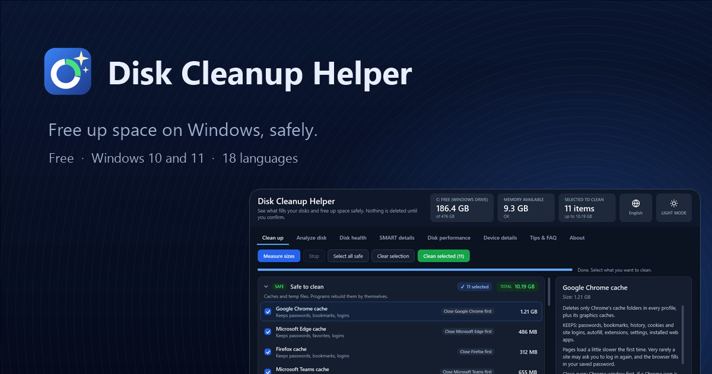
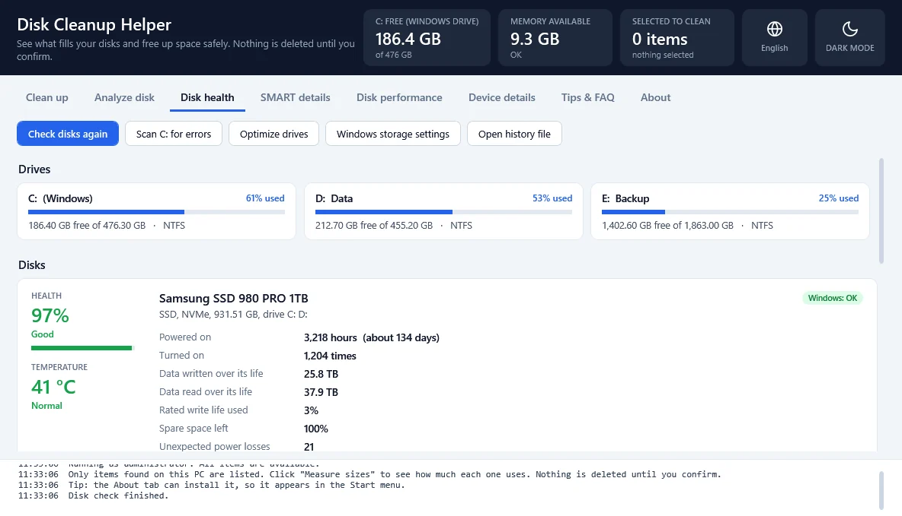

  

<h1 align="center">Disk Cleanup Helper · website</h1>

  <a href="https://philip-droubi.github.io/disk-cleanup-helper/"><b>Open the website</b></a>
  &nbsp;·&nbsp;
  <a href="https://github.com/Philip-Droubi/disk-cleanup-helper/releases/latest/download/DiskCleanupHelper.zip">Download the app</a>
  &nbsp;·&nbsp;
  <a href="https://github.com/Philip-Droubi/disk-cleanup-helper/releases">All versions</a>
  &nbsp;·&nbsp;
  <a href="https://github.com/Philip-Droubi/disk-cleanup-helper/issues">Report a problem</a>

This branch is the published website of **Disk Cleanup Helper**, a free Windows app that shows what fills your
drives, cleans the caches and leftovers you don't need, and keeps an eye on your disks' health. Nothing is deleted
until you confirm.

GitHub Pages serves this branch exactly as it is. Each update of the site replaces it with a single new commit.

| **Address** | https://philip-droubi.github.io/disk-cleanup-helper/ |
|---|---|
| **App version shown** | [1.1](https://github.com/Philip-Droubi/disk-cleanup-helper/releases/tag/v1.1) |
| **Built** | 2026-10-20 |
| **Languages** | 18: English, العربية, Deutsch, Español, فارسی, Français, Bahasa Indonesia, Italiano, 日本語, 한국어, Polski, Português (Brasil), Русский, Türkçe, Українська, اردو, Tiếng Việt, 简体中文 |
| **Privacy** | no cookies, no tracking, no requests to other sites; your chosen theme and language are remembered in your browser only |

## A look at the app

  <picture>
    <source media="(prefers-color-scheme: dark)" srcset="images/health-dark.webp">
    
  </picture>

The screenshot uses made-up data.

## What is in this branch

| Path | What it is |
|---|---|
| `index.html` | the English page, at the site's root |
| `ar/`, `de/`, `es/` … | one folder for each of the other 17 languages, each with its own page |
| `_next/` | the site's scripts, styles and font |
| `images/` | screenshots of the app, light and dark |
| `og.jpg`, `icon.png`, `apple-icon.png` | the picture shown when the site is shared, and the site icons |
| `sitemap.xml` | every language page, for search engines |
| `404.html` | the page for addresses that do not exist |
| `index.txt`, `__next.*`, `404/`, `_not-found/` | page data the site loads when you move between pages, and the files behind the 404 page |
| `.nojekyll` | tells GitHub Pages to serve the files as they are |

## Found a problem?

Please [open an issue](https://github.com/Philip-Droubi/disk-cleanup-helper/issues): that is the quickest way to get
something on the site fixed. Pull requests to this branch aren't accepted.

The app itself is free and open source under the GNU GPL v3: its code is on the
[`main` branch](https://github.com/Philip-Droubi/disk-cleanup-helper).
