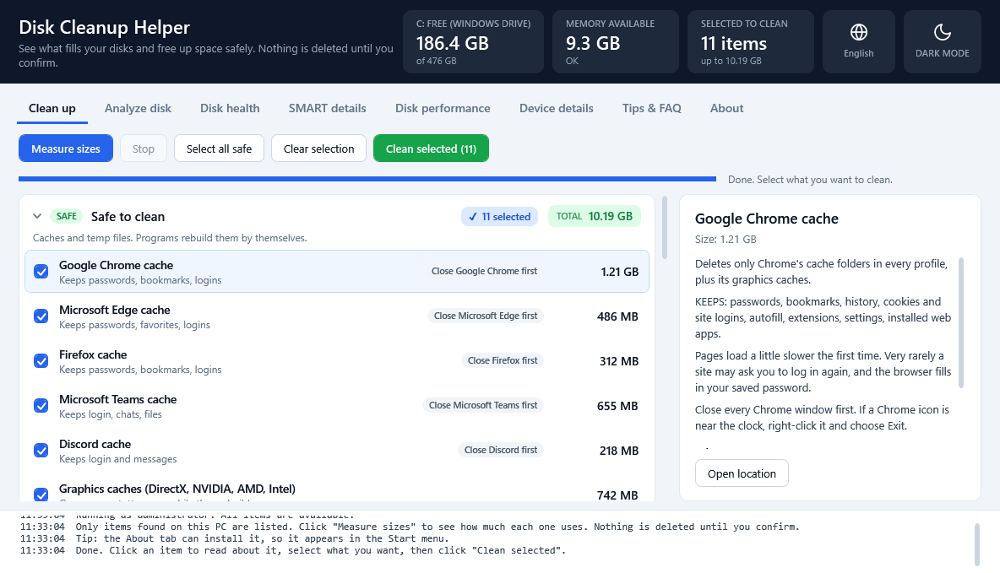
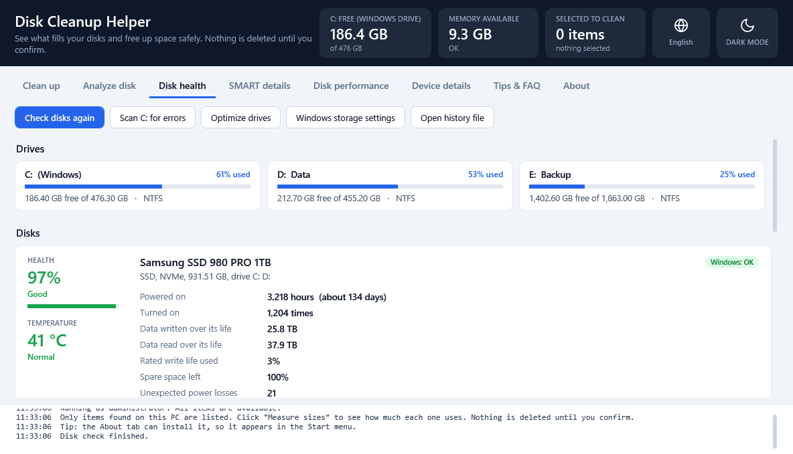

# Disk Cleanup Helper

**Free up space on Windows 10 and 11, safely.** 
See what fills your disks, clean caches and leftovers, and check your disks' health.
Nothing is deleted until you confirm.

**[Download for Windows](https://github.com/Philip-Droubi/disk-cleanup-helper/releases/latest/download/DiskCleanupHelper.zip)** &nbsp;·&nbsp; **[Visit the website](https://philip-droubi.github.io/disk-cleanup-helper/)**

Free · One small file · 18 languages · Light and dark · [What's new](https://github.com/Philip-Droubi/disk-cleanup-helper/releases/latest)

<picture>
  <source media="(prefers-color-scheme: dark)" srcset="docs/images/cleanup-dark.png">
  
</picture>

## What it does

| Tab | What you get |
|---|---|
| **Clean up** | Safe cleanup of browser and app caches, temp files, old update files, Windows leftovers and more. Every item explains what you keep and what you lose. |
| **Analyze disk** | The biggest folders and files on any drive, so you can find what takes your space. |
| **Disk health** | Whether each disk is healthy and how full each drive is, with a live temperature and history charts. Starts Windows' own error scan. |
| **SMART details** | The full self-monitoring data of each disk. |
| **Disk performance** | Live disk activity, and a speed test you can compare later. |
| **Device details** | Windows, processor, memory, graphics, screens, storage, battery, network and sound. Copy it or save it as a text file. |
| **Tips & FAQ** | Simple habits that keep your disk from filling up, and answers to common questions. |

<picture>
  <source media="(prefers-color-scheme: dark)" srcset="docs/images/health-dark.png">
  
</picture>

## Safe by design

- Nothing is deleted until you select it and confirm. You see the exact list first.
- The Clean up tab never touches your documents, photos, music, videos, desktop or downloads.
- Browser and app caches keep your passwords, bookmarks, history and logins.
- It asks you to close a browser or app before cleaning its cache.
- Big things like a previous Windows installation, System Restore, Docker and WSL are only shown, never deleted.
- Windows and program files are protected in Analyze disk.
- Files cleaned by the Clean up tab do not go to the Recycle Bin, so read an item before you tick it.

## Private

It sends nothing about your PC. No account, no ads. The only connection it makes is to ask GitHub whether a new
version exists (at most once a day, and you can turn it off). What was cleaned is logged on your PC only.

**Updates:** a new version downloads in the background and is checked (SHA256 and version number) before it
replaces the old one. Click **Restart now**, or it installs when you close the app.

## 18 languages

English, العربية, Deutsch, Español, فارسی, Français, Bahasa Indonesia, Italiano, 日本語, 한국어, Polski,
Português (Brasil), Русский, Türkçe, Українська, اردو, Tiếng Việt, 简体中文.
Arabic, Persian and Urdu are shown right to left.

## Get started

1. Download `DiskCleanupHelper.zip` from the [latest release](https://github.com/Philip-Droubi/disk-cleanup-helper/releases/latest) and unzip it.
2. Double-click `DiskCleanupHelper.exe` and click **Yes** when Windows asks for permission. If you click No, it
   still opens, but the items that need admin rights are grey.
3. If Windows shows "Windows protected your PC", click **More info**, then **Run anyway**. This appears for new
   programs that Microsoft does not know yet. Each release lists the SHA256 of `DiskCleanupHelper.exe`, so you can
   check the program after unzipping.
4. To keep it, open the **About** tab and click **Install on this PC**. It gets a Start menu entry and a desktop
   shortcut, and you can uninstall it from Settings > Apps. No admin rights are needed to install.

**Requirements:** Windows 10 or Windows 11. Nothing else to install: it uses the .NET Framework built into Windows.

## Feedback

Found a bug or have an idea? [Open an issue](https://github.com/Philip-Droubi/disk-cleanup-helper/issues).

## Build it yourself

Everything you need is in this repository and in Windows itself: run `build.cmd -Rebuild`. The
[developer guide](docs/DEVELOPING.md) explains the code, the translations and the test switches, and
[CONTRIBUTING.md](CONTRIBUTING.md) how to suggest a change.

## License

Copyright (C) 2026 Philip Droubi. Disk Cleanup Helper is free and open source under the
[GNU General Public License v3](LICENSE) (version 3 only), with two additional terms in [NOTICE](NOTICE) that section 7
of the license allows:

- **Credit:** the app shows "Disk Cleanup Helper by Philip Droubi - https://github.com/Philip-Droubi" in its About tab
  and its read-me files, and copies keep it. A changed version shows **"Based on Disk Cleanup Helper by Philip Droubi -
  https://github.com/Philip-Droubi"** in its place, as a clickable link where links work. Copies and changed versions
  also keep [NOTICE](NOTICE) and the copyright header of each source file.
- **Changed versions** must say they are changed and must not present themselves as the original.

You may use, study, change and share it under those terms. It comes with no warranty: back up important files before
cleaning any computer.

---

Made by [Philip Droubi](https://philip-droubi.github.io/Philip_Droubi_portfolio/) · [LinkedIn](https://www.linkedin.com/in/philip-droubi/)

